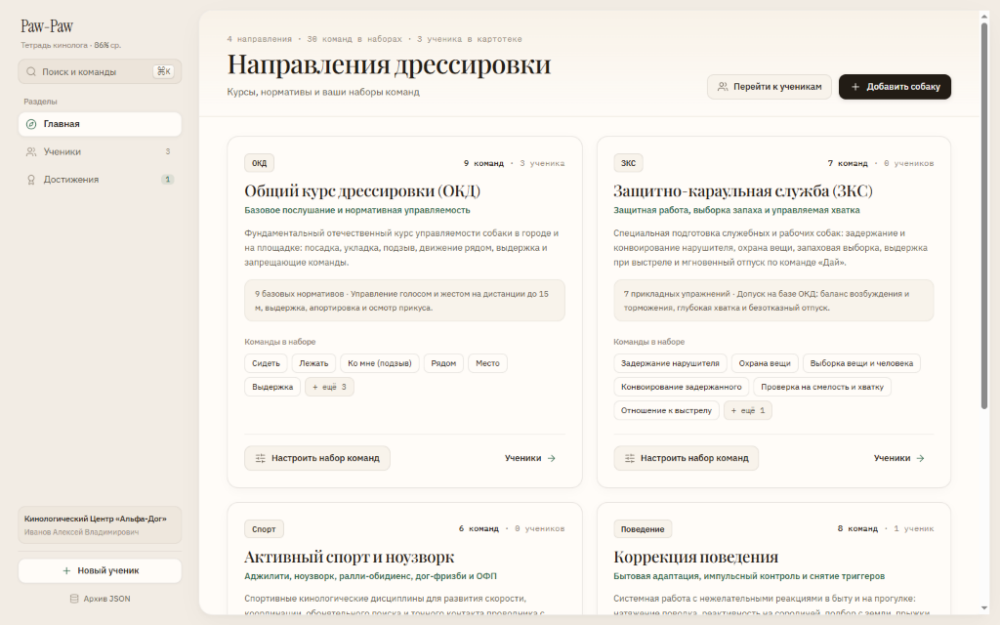
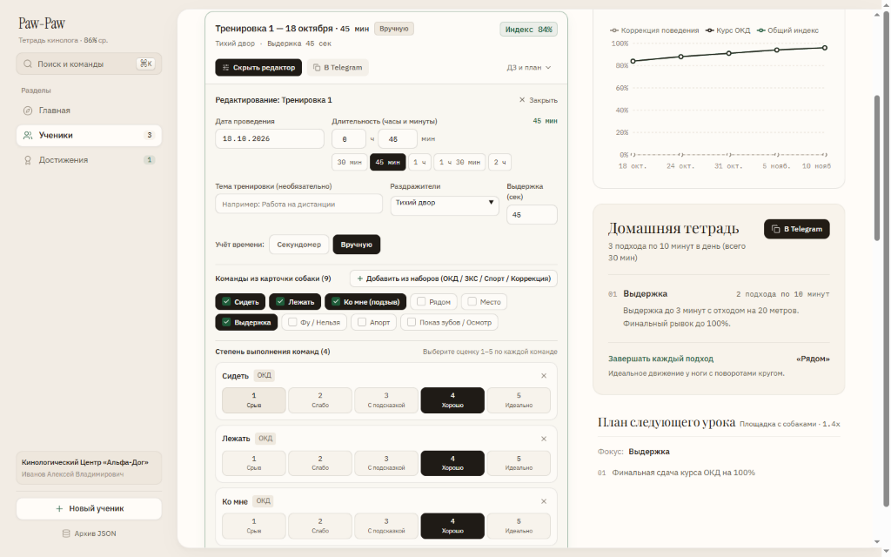
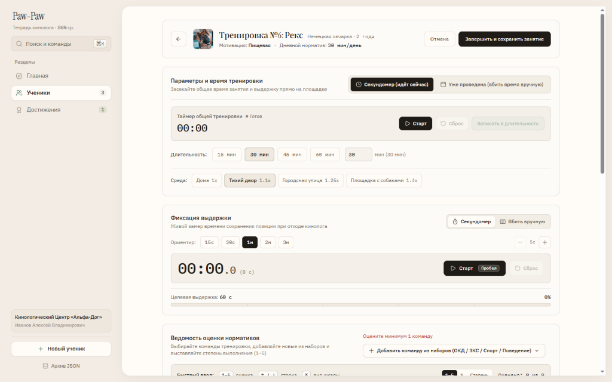

<div align="center">

# 🐾 Paw-Paw · Рабочая тетрадь кинолога

<a href="#"></a>

<br/>

<a href="https://github.com/GL1NoMe5/Paw-Paw/releases/latest/download/Paw-Paw-Portable.zip">
  
</a>
<a href="https://github.com/GL1NoMe5/Paw-Paw/releases/latest/download/Paw-Paw-Portable.html">
  
</a>


<br/><br/>

**[✨ Возможности](#-возможности)** &nbsp;•&nbsp; **[🚀 Скачать и запустить](#-быстрый-старт)** &nbsp;•&nbsp; **[🖼️ Скриншоты](#️-скриншоты)** &nbsp;•&nbsp; **[📖 FAQ](#-faq)**

<br/>



</div>

<br/>

## 🐕 Что такое Paw-Paw?

**Paw-Paw** — это уютная настольная тетрадь кинолога. Ведите карточки собак, оценивайте навыки нажатием одной клавиши, отправляйте владельцам готовые домашние задания в Telegram и печатайте красивые архивные дипломы А4 — прямо с компьютера, без серверов и сложных настроек.

<br/>

## ✨ Возможности

<table>
<tr>
<td width="50%" valign="top">

📋 **Картотека в разделе «Ученики»**<br/>
<sub>Паспорт собаки, автоподбор породы с первых букв, свой дневной норматив времени (мин/день), команды «до кинолога» и особенности.</sub>

<br/>

🧭 **Свои наборы команд (ОКД, ЗКС, Спорт)**<br/>
<sub>Блоки с направлениями прямо на главной и гибкий конструктор собственных команд под любую программу.</sub>

<br/>

📅 **Градация тренировок по датам**<br/>
<sub>Хронологический журнал «Тренировка 1, 2…» в профиле собаки: выбирайте команды и степень их выполнения от 1 до 5.</sub>

<br/>

⏱️ **Секундомер или ручной ввод занятия**<br/>
<sub>Запускайте живой секундомер на площадке или вручную вносите дату и длительность уже проведённой тренировки.</sub>

</td>
<td width="50%" valign="top">

🎓 **Конструктор сертификатов А4 («Достижения»)**<br/>
<sub>4 шаблона, 5 палитр, эмблема лапки с сердечком, опциональные % ОКД и имя кинолога по желанию, экспорт в PNG/PDF.</sub>

<br/>

📝 **Своё ДЗ: Дома · Перед прогулкой · На прогулке**<br/>
<sub>Составляйте домашнее задание вручную в 3 блока (или автоподбором) и копируйте готовый отчёт для **Telegram**.</sub>

<br/>

🌓 **Светлая и тёмная тема + `Ctrl + K`**<br/>
<sub>Переключение между тёплой бумажной и ночной тёмной темами в 1 клик, плюс быстрая командная палитра.</sub>

<br/>

💾 **Полностью автономный Portable**<br/>
<sub>Работает из одного файла. Все данные хранятся локально на ПК + есть экспорт/импорт всей базы в <code>.json</code>.</sub>

</td>
</tr>
</table>

<br/>

## 🚀 Быстрый старт

> [!TIP]
> **Ничего устанавливать не нужно** — ни Python, ни Node.js, ни `git clone`.

**1.** Нажми сюда, чтобы скачать готовый архив:
👉 **[⬇️ Скачать Paw-Paw-Portable.zip](https://github.com/GL1NoMe5/Paw-Paw/releases/latest/download/Paw-Paw-Portable.zip)** *(или скачай один файл **[Paw-Paw-Portable.html](https://github.com/GL1NoMe5/Paw-Paw/releases/latest/download/Paw-Paw-Portable.html)**)*.

**2.** Распакуй архив в любую папку и дважды кликни **`Start-Paw-Paw.bat`** — откроется чистое десктопное окно приложения 🐾

**3.** Либо просто открой **`Paw-Paw-Portable.html`** двойным кликом в любом браузере — внутри уже предзаполнены 3 демо-собаки (**Рекс**, **Булочка** и **Юта**), которые можно редактировать или заменить своими.

<details>
<summary><b>💻 Хочешь запустить или собрать из исходников?</b></summary>

<br/>

Если у тебя установлен **Node.js**, просто дважды кликни **`build_portable.bat`** — скрипт сам соберёт свежий `portable/Paw-Paw-Portable.html` и архив `portable/Paw-Paw-Portable.zip`.

Либо через терминал:
```bash
npm install
npm run dev            # режим разработки
npm run build:portable # сборка автономного Portable
```

</details>

<br/>

## 🖼️ Скриншоты

<div align="center">


<sub><b>Главная страница — направления дрессировки (ОКД, ЗКС, Активный спорт, Коррекция) и наборы команд</b></sub>

<br/><br/>


<sub><b>Раздел «Ученики» — градация тренировок по датам, выбор команд и оценка степени выполнения (1–5)</b></sub>

<br/><br/>


<sub><b>Режим занятия — выбор между живым секундомером и ручным вводом уже проведённой тренировки</b></sub>

<br/><br/>


<sub><b>Раздел «Достижения» — настройка данных и генератор дипломов формата А4 (PNG HD и PDF)</b></sub>

</div>

<br/>

## ⚡ Как это работает

<div align="center">

<table>
<tr>
<td align="center" width="25%">🧭<br/><b>1. Настрой наборы</b><br/><sub>Собери команды для ОКД, ЗКС, спорта или коррекции</sub></td>
<td align="center" width="25%">🐕<br/><b>2. Веди учеников</b><br/><sub>Создай карточку с породой и нормативом минут</sub></td>
<td align="center" width="25%">📅<br/><b>3. Запиши уроки</b><br/><sub>Запусти таймер или вбей прошлую тренировку вручную</sub></td>
<td align="center" width="25%">🏅<br/><b>4. Выдай диплом</b><br/><sub>Открой «Достижения» и скачай сертификат А4</sub></td>
</tr>
</table>

</div>

<br/>

## 📖 FAQ

<details>
<summary><b>Где сохраняются мои собаки и тренировки?</b></summary>
<br/>
Все данные автоматически сохраняются в локальном хранилище твоего компьютера. Чтобы сохранить резервную копию в файл или перенести базу на другой ноутбук, нажми <b>«Архив JSON»</b> в левом нижнем углу.
</details>

<details>
<summary><b>Можно ли добавлять свои команды и настраивать программы под себя?</b></summary>
<br/>
Да! Прямо на главной странице в любой дисциплине (ОКД, ЗКС, Активный спорт, Коррекция) можно настроить свой набор команд кнопкой <b>«Настроить команды»</b>, а в анкете ученика — вручную задать породу, дневной норматив минут, и любые прошлые тренировки.
</details>

<details>
<summary><b>Работает ли Portable-версия без интернета?</b></summary>
<br/>
Да, весь код и стили упакованы внутрь одного файла <code>Paw-Paw-Portable.html</code>. Ты можешь скинуть его на флешку и открыть на любом компьютере.
</details>

<br/>

---

<div align="center">

<i>«Каждый хороший мальчик (и каждая хорошая девочка) заслуживает свой диплом.»</i><br/>
<sub>⭐ Если Paw-Paw оказался полезен — поставь звёздочку репозиторию!</sub>

</div>
