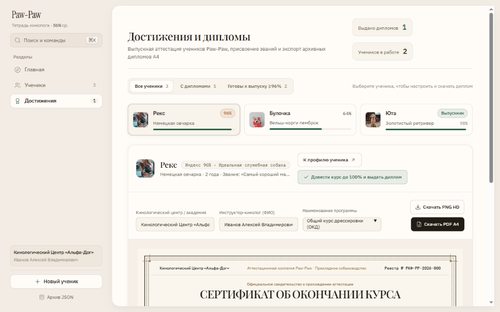

<div align="center">

# 🐾 Paw-Paw · Рабочая тетрадь кинолога

<a href="#"></a>

<br/>

<a href="https://github.com/GL1NoMe5/Paw-Paw/releases/latest/download/Paw-Paw-Portable.zip">
  
</a>
<a href="https://github.com/GL1NoMe5/Paw-Paw/releases/latest/download/Paw-Paw-Portable.html">
  
</a>


<br/><br/>

**[✨ Возможности](#-возможности)** &nbsp;•&nbsp; **[🚀 Скачать и запустить](#-быстрый-старт)** &nbsp;•&nbsp; **[🖼️ Скриншоты](#️-скриншоты)** &nbsp;•&nbsp; **[📖 FAQ](#-faq)**

<br/>


</div>

<br/>

## 🐕 Что такое Paw-Paw?

**Paw-Paw** — это уютная настольная тетрадь кинолога. Ведите карточки собак, оценивайте навыки нажатием одной клавиши, отправляйте владельцам готовые домашние задания в Telegram и печатайте красивые архивные дипломы А4 — прямо с компьютера, без серверов и сложных настроек.

<br/>

## ✨ Возможности

<table>
<tr>
<td width="50%" valign="top">

📋 **Живая картотека собак**<br/>
<sub>Паспорт ученика, возраст, вес, контакты владельца, мотивация, любимые лакомства, аллергии и триггеры.</sub>

<br/>

⌨️ **Оценка навыков в 1 клик**<br/>
<sub>Наведите курсор на навык и нажмите <code>1–5</code>. Прогресс по ОКД и коррекции поведения считается сам.</sub>

<br/>

📝 **Умная «Домашняя тетрадь»**<br/>
<sub>Сама находит слабые места, расписывает подходы по минутам и копирует красивый отчёт для **Telegram**.</sub>

<br/>

⏱️ **Режим урока и секундомер выдержки**<br/>
<sub>Коэффициенты сложности среды (от дома до собачьей площадки) и встроенный таймер выдержки.</sub>

</td>
<td width="50%" valign="top">

🎓 **Наградные дипломы А4 (PNG и PDF)**<br/>
<sub>Архивный сертификат с печатью, фото и титулом *«Самый хороший мальчик»* / *«Самая хорошая девочка»*.</sub>

<br/>

📈 **График прогресса и журнал занятий**<br/>
<sub>Наглядная динамика индекса «Идеальная собака» от первого урока до выпуска.</sub>

<br/>

⚡ **Командная палитра `Ctrl + K`**<br/>
<sub>Мгновенный поиск собаки, запуск тренировки или выдача диплома без помощи мыши.</sub>

<br/>

💾 **Полностью автономный Portable**<br/>
<sub>Работает из одного файла. Все данные хранятся на вашем ПК + есть экспорт/импорт всей базы в <code>.json</code>.</sub>

</td>
</tr>
</table>

<br/>

## 🚀 Быстрый старт

> [!TIP]
> **Ничего устанавливать не нужно** — ни Python, ни Node.js, ни `git clone`.

**1.** Нажми сюда, чтобы скачать готовый архив:
👉 **[⬇️ Скачать Paw-Paw-Portable.zip](https://github.com/GL1NoMe5/Paw-Paw/releases/latest/download/Paw-Paw-Portable.zip)** *(или скачай один файл **[Paw-Paw-Portable.html](https://github.com/GL1NoMe5/Paw-Paw/releases/latest/download/Paw-Paw-Portable.html)**)*.

**2.** Распакуй архив в любую папку и дважды кликни **`Start-Paw-Paw.bat`** — откроется чистое десктопное окно приложения 🐾

**3.** Либо просто открой **`Paw-Paw-Portable.html`** двойным кликом в любом браузере — внутри уже предзаполнены 3 демо-собаки (**Рекс**, **Булочка** и **Юта**), которые можно редактировать или заменить своими.

<details>
<summary><b>💻 Хочешь запустить или собрать из исходников?</b></summary>

<br/>

Если у тебя установлен **Node.js**, просто дважды кликни **`build_portable.bat`** — скрипт сам соберёт свежий `portable/Paw-Paw-Portable.html` и архив `portable/Paw-Paw-Portable.zip`.

Либо через терминал:
```bash
npm install
npm run dev            # режим разработки
npm run build:portable # сборка автономного Portable
```

</details>

<br/>

## 🖼️ Скриншоты

<div align="center">


<sub><b>Рабочий лист ученика и «Домашняя тетрадь»</b></sub>

<br/><br/>


<sub><b>Генератор наградных дипломов формата А4 (экспорт в PNG HD и PDF)</b></sub>

</div>

<br/>

## ⚡ Как это работает

<div align="center">

<table>
<tr>
<td align="center" width="25%">🐕<br/><b>1. Выбери ученика</b><br/><sub>Создай карточку собаки и укажи особенности</sub></td>
<td align="center" width="25%">⌨️<br/><b>2. Оцени навыки</b><br/><sub>Выставь баллы 1–5 на уроке или прямо в списке</sub></td>
<td align="center" width="25%">📲<br/><b>3. Отправь ДЗ</b><br/><sub>Скопируй готовую памятку в Telegram в 1 клик</sub></td>
<td align="center" width="25%">🏅<br/><b>4. Выдай диплом</b><br/><sub>Скачай именной сертификат А4 в PDF или PNG</sub></td>
</tr>
</table>

</div>

<br/>

## 📖 FAQ

<details>
<summary><b>Где сохраняются мои собаки и тренировки?</b></summary>
<br/>
Все данные автоматически сохраняются в локальном хранилище твоего компьютера. Чтобы сохранить резервную копию в файл или перенести базу на другой ноутбук, нажми <b>«Архив JSON»</b> в левом нижнем углу.
</details>

<details>
<summary><b>Можно ли добавлять свои навыки и менять всё под себя?</b></summary>
<br/>
Да! Можно менять любые данные анкеты, добавлять собственные навыки кнопкой <b>«+ Навык»</b>, удалять ненужные дисциплины и настраивать ФИО кинолога и название центра прямо на дипломе.
</details>

<details>
<summary><b>Работает ли Portable-версия без интернета?</b></summary>
<br/>
Да, весь код и стили упакованы внутрь одного файла <code>Paw-Paw-Portable.html</code>. Ты можешь скинуть его на флешку и открыть на любом компьютере.
</details>

<br/>

---

<div align="center">

<i>«Каждый хороший мальчик (и каждая хорошая девочка) заслуживает свой диплом.»</i><br/>
<sub>⭐ Если Paw-Paw оказался полезен — поставь звёздочку репозиторию!</sub>

</div>
